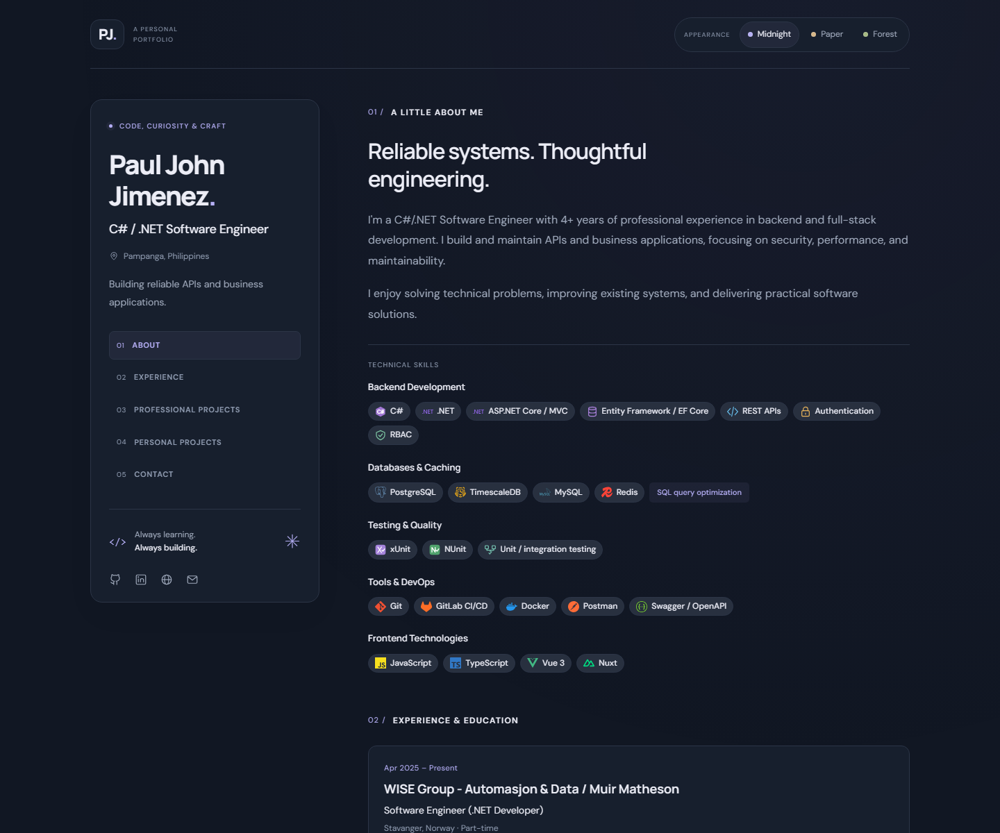

# Paul John Jimenez — Software Engineer Portfolio

A responsive personal portfolio presenting my experience as a C#/.NET Software Engineer, selected professional work, and earlier personal projects.

[View the live portfolio](https://paulrndp.github.io/the-portfolio/)



## Overview

The portfolio is designed as a focused, accessible introduction to my work. It combines a concise professional profile with employment history, technical skills, production project links, and archived personal builds.

## Highlights

- Responsive layout for desktop, tablet, and mobile screens
- Midnight, Paper, and Forest themes with saved preferences
- Professional project cards with live website previews
- Personal project archive with original artwork and source links
- Accessible navigation, keyboard focus states, and semantic markup
- Lightweight implementation with no frontend framework or build step

## Built with

- HTML5
- Modern CSS
- Vanilla JavaScript
- GitHub Pages

## Project structure

```text
.
├── assests/
│   ├── icons/          # Technology icons
│   └── imgs/           # Professional and personal project previews
├── docs/               # Repository documentation assets
├── index.html          # Page structure and content regions
├── portfolio.js        # Portfolio data and project information
├── script.js           # Rendering and interaction logic
├── styles.css          # Layout, themes, and responsive styles
└── theme.js            # Early theme initialization
```

## Run locally

No installation or build step is required. Clone the repository and serve its root with any static HTTP server:

```bash
git clone https://github.com/paulrndp/the-portfolio.git
cd the-portfolio
python -m http.server 4173
```

Open `http://localhost:4173` in a browser.

## Deployment

The site is deployed automatically through GitHub Pages whenever the `main` branch is updated.

## Contact

- [LinkedIn](https://www.linkedin.com/in/paul-john-jimenez-064692124/)
- [GitHub](https://github.com/paulrndp)
- [Email](mailto:paulrndp@gmail.com)
